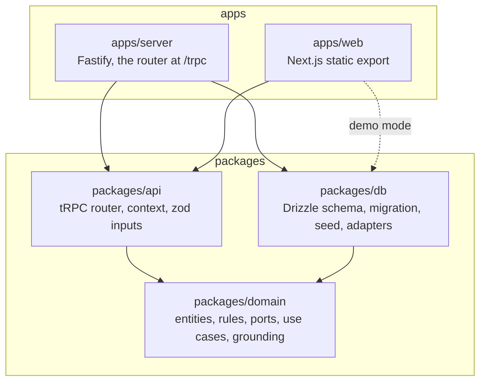
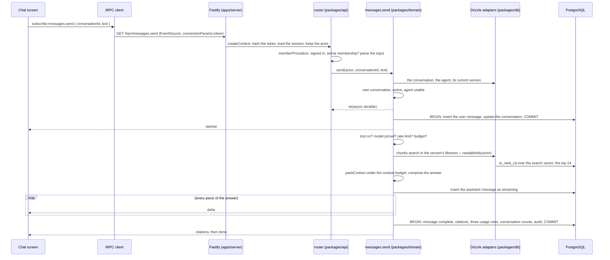
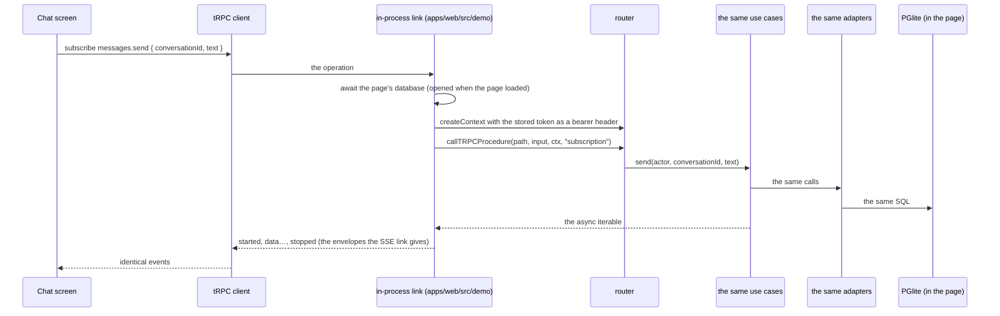
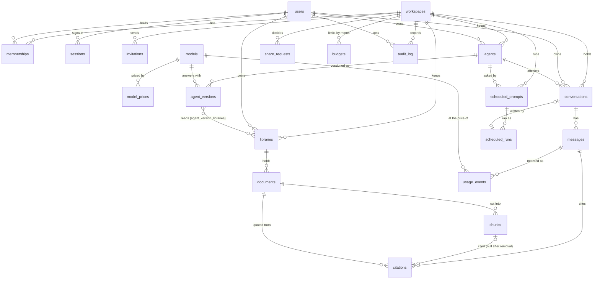
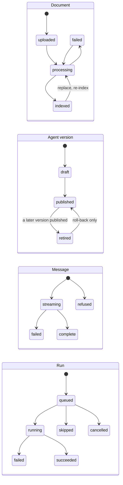
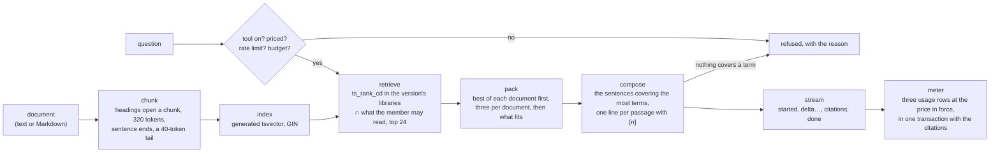
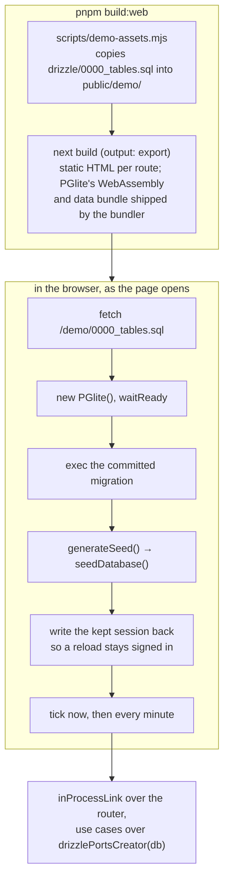

# Architecture

How the pieces fit: the packages and what each may import, the path a question takes on the server and in the demo, the data model, the state machines, the grounding pipeline, and how the demo runs PostgreSQL in the page. The rules themselves are in `domain.md`; the procedures are in `api.md`; the reasons behind the choices are in `decisions/`.

## Components

Three packages and two apps in one pnpm workspace. The arrows are the only imports allowed; `packages/domain` imports nothing from the workspace and no framework.

`packages/domain` holds the entities, the text rules (the approximate tokenizer, sentence units, the chunker), money as micro-dollars, the twelve transition tables, the access rules, the grounding pipeline (terms, packing, the extractive composer behind the `Answerer` port, the meter, the rate limit), the ports (eighteen repositories, a unit of work, a clock, an id generator) as interfaces, an in-memory implementation of them for the tests, and the use cases as factories that take their ports. A use case returns a `Result`: `ok(value)` or `fail(code, message, reason)`, with six codes that map one to one onto tRPC error codes, so a refusal is a value that can travel to a screen without a server in between. `useCasesCreator` builds every use case once over one set of dependencies; the server and the demo each call it.

`packages/db` is the Drizzle schema (twenty-two tables, eighteen enums, the checks and unique constraints), the generated migration in `drizzle/` with the search vector and its GIN index, the hand-written corpus, the seed generator (about 13,500 coherent rows from a fixed seed), and `drizzlePortsCreator`, which implements the domain's ports over a Drizzle handle. The handle is node-postgres on the server and PGlite in the tests and in the browser; the adapters do not know which. The full-text search and the permission filter are SQL in this package.

`packages/api` is the tRPC v11 router: one procedure per use case, each input a zod schema, three kinds of procedure (public, member, admin), and `createContext`, which turns a bearer token into the actor. A procedure takes the context and never a request, so Fastify can serve the router and the demo can call it in-process. The web app imports the router's type and the input schemas from here.

`apps/server` is the server's composition root: the only folder where a Fastify request or reply exists. It connects to PostgreSQL, applies the migration, loads the seed when `SEED=1`, builds the use cases over the Drizzle adapters, mounts the router at `/trpc` with helmet, CORS from `WEB_ORIGIN` and a rate limit on `/trpc/auth.*`, and runs the tick every minute.

`apps/web` is the app. A screen asks hooks (TanStack Query through the tRPC query-options proxy); the hooks ask one tRPC client; the client's links are chosen in one function, `linksFor(token)`. With `NEXT_PUBLIC_API_URL` set the links are HTTP: the batch link with the bearer header for queries and mutations, the server-sent-events link with the token in the connection params for the streamed answer. With it empty the one link calls the router in-process on PGlite. Nothing above that function knows the difference.

## A question, on the server

`messages.send` from a signed-in member, as the code runs it. It is a tRPC subscription: the answer arrives as events over server-sent events.

The checks run cheapest first and each one that fails is a refusal: a terminal message with its reason (`tool_off`, `no_price`, `rate_limited`, `budget_exhausted`, `no_sources`), an audit row, and no usage. Everything that lands at the end lands in one database transaction, through `unitOfWork.run`: the completed message, its citations, the three usage rows at the prices in force, the conversation's new counts and the audit row land together or not at all, so a half-written answer never exists. A model that throws marks the message `failed` and still meters the prompt and the context, since those tokens were spent.

The order of refusals for any procedure is fixed by the router: `UNAUTHORIZED` for no or a dead token, `FORBIDDEN` for a member on an admin procedure, both before the input is read; then `BAD_REQUEST` when the zod schema refuses the shape; then whatever the use case returns, `CONFLICT` for a move the state machine forbids or a duplicate, `PRECONDITION_FAILED` for a rule such as the last admin, `NOT_FOUND` for a record that does not exist or that the caller may not read. The error carries the rule's `reason` in its data, so a screen switches on it without parsing the message.

## The same question, in the demo

Everything from the router down is the same code the server runs. The link is the demo's whole transport: per operation it builds the context the server builds, calls the procedure with tRPC's own `callTRPCProcedure`, and puts the answer in the envelope the client expects; a subscription's async iterable becomes `started`, `data` and `stopped`, which is what the SSE link produces, so the chat folds the same events. Nothing is serialised in-process, so a `Date` stays a `Date`; an error goes through the router's own formatter, so `data.code` and `data.reason` are what the server would have sent. What the demo lacks is Fastify's: the sign-in rate limit, CORS and the request log. The member rate limit and the budget are the domain's and work in both.

## The data model

Twenty-two tables. Tokens are integers; money is `bigint` micro-dollars; prices are integer micro-dollars per thousand tokens with a validity range; every state is a PostgreSQL enum; times are `timestamptz`.

The relations that carry the product:

- A **membership** is a user in a workspace with a role (`member`, `admin`) and a standing (`active`, `suspended`); a user can hold several, and a **session** names the workspace it is in. The session row keeps only the SHA-256 of the token and an expiry.
- A **library** belongs to a workspace and an owner and is `private` or `workspace`; a **document** in it carries its text, a version number and a status, and its **chunks** carry `[start_char, end_char)` such that `body.slice(start, end)` is exactly the chunk's body, the heading path above it, a token count, and the generated search vector.
- An **agent** has versions; `current_version_id` names the one that answers. An **agent version** has instructions, a model, a context budget and the libraries it reads (the join table). Only the owner's own and the workspace-shared libraries can be chosen.
- A **share request** names a library or an agent and ends `approved`, `declined` or `withdrawn`; one open request per subject. Approval flips the subject's visibility.
- A **conversation** records the agent and the version that answered; a **message** is the user's or the assistant's, with its status, its three token counts and, when refused, the reason. A **citation** keeps the quote, the span and the document version it quoted, so the quote survives a replacement or a removal of the chunk.
- A **usage event** is one kind of token (`input`, `cached_input`, `output`) for one message at the price in force at that instant, with `micros_per_1k` snapshotted and `cost_micros` computed once. A **budget** is one month's limit for a workspace; the month's spend is the sum of its usage rows, never a column.
- A **scheduled prompt** asks an agent a question on a cadence in a time zone; each **run** records the outcome and the conversation it wrote.
- Every transition writes an **audit_log** row: actor, action, entity, before, after, reason.

The constraints the database enforces under the code: foreign keys on every relation above, `unique(email)`, `unique(workspace_id, user_id)` on memberships, `unique(workspace_id, slug)` on libraries and agents, `unique(agent_id, version)`, `unique(document_id, ordinal)` on chunks, `unique(conversation_id, ordinal)` on messages, `unique(message_id, index)` on citations, `unique(workspace_id, month)` on budgets, `unique(token_hash)` on sessions and invitations; `end_char > start_char` on chunks and citations, positive token counts on chunks, non-negative tokens and money everywhere, `valid_to > valid_from` on prices, `version >= 1` on documents and agent versions, retention between 1 and 3,650 days, emails stored lower-case, a refused message carrying a reason and no other message carrying one, a budget's month as `YYYY-MM`, a schedule's minute, weekday and day in range and present only when its cadence needs them. `test/schema.test.ts` proves the refusals.

## The state machines

Twelve, as tables in `packages/domain/src/transitions.ts`; a use case asks `move(table, entity, from, to)` before touching anything, so a forbidden move is a `CONFLICT` with the reason `forbidden_transition` and never a row.

The others: an agent goes `active → archived`; a share request goes `requested → approved | declined | withdrawn`; a library's or an agent's visibility goes `private ↔ workspace`; an invitation goes `sent → accepted | revoked | expired`; a membership goes `active ↔ suspended`; a conversation goes `active → archived → active | deleted`; a scheduled prompt goes `active ↔ paused` and either `→ ended`; a budget month goes `open → closed`. `domain.md` has each with its rules.

## The grounding pipeline

From a document to a cited answer. The chunker runs at upload; the rest runs at every question.

Two properties hold it together. Every chunk and every citation is exactly `document.slice(start, end)`, so what the chat quotes is what the viewer highlights. And the permission filter in SQL (`libraries.readableIds`) is the twin of the rule in code (`canReadLibrary`); a generated test proves the two agree, so retrieval can never see a library the member could not open.

## Demo mode

The live demo is the static export of the web app with `NEXT_PUBLIC_API_URL` empty. There is no server behind it.

PGlite's loader finds its WebAssembly and data bundle with `new URL(…, import.meta.url)`, which the bundler understands and ships as hashed static files, so only the migration is copied. One database per page, as a promise with a status beside it, started by the session provider when the page opens instead of at the first call, so the sign-in page can say "loading" and "ready". The database is rebuilt from the seed on every load; the session the browser kept is written back into it for a user the seed knows with an active membership while the copy is live, which is the one thing the demo does that the server does not. The data lives until the tab is closed.

## Tests, by layer

| Layer | Runner | Against | What |
| --- | --- | --- | --- |
| `packages/domain` | Vitest, fast-check | in-memory ports | the text rules as properties (tokenizer, sentences, chunker, packer, composer, meter, rate limit), money, passwords, cursors, the transition tables, the access rules, every use case including the pipeline and the tick, the ports' contract |
| `packages/db` | Vitest | PGlite | the schema's refusals, the adapters through the same contract test as the in-memory ports, the search on the seed, the SQL permission filter against the rule in code on generated cases, the seed's determinism, coherence and reconciliation |
| `packages/api` | Vitest | in-memory ports | the middleware, the error mapping, the in-process stream |
| `apps/server` | Vitest | PGlite with the seed, over HTTP | the access matrix, the workflows, upload and ask over SSE, the budget refusal, `runNow`, the ticker, forbidden transitions, the last admin, cursor paging, the sign-in rate limit |
| `apps/web` | Vitest, Testing Library, jsdom | in-memory ports and a small router | the forms, the question box, the stream reducer, the message list, the viewer's segments, the cadence, the chart's series, the audit diff; the in-process link, the session restore, the demo database under Node |
| `apps/web/e2e` | Playwright | the demo build in Chromium | ask and cite; build, share, approve, use; the budget refusal and recovery; invite and join |

`pnpm test` runs the first five; `pnpm build:web && pnpm test:e2e` the last.
